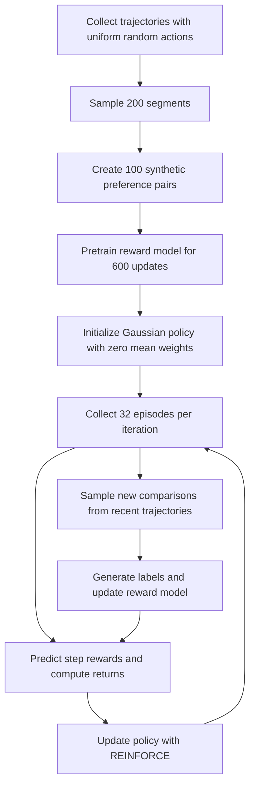

# Mini RL Teacher

**English** | [简体中文](README.zh-CN.md)

A NumPy-only introduction to reinforcement learning from preferences, with a 2D control task, a learned reward model, and terminal visualization.

Start with [mini_rl_teacher.py](mini_rl_teacher.py). This standalone Python file demonstrates the full loop: **compare behavior segments → learn a reward model → optimize a policy using predicted rewards → collect new comparisons**.

The mini version uses a 2D ball environment, synthetic preferences, and REINFORCE. Its neural network, backpropagation, and Adam optimizer are implemented in NumPy. The repository also retains the original RL-Teacher code for MuJoCo, TRPO/PPO, and human feedback collection for comparison. The original project implements Christiano et al.'s 2017 paper, [Deep Reinforcement Learning from Human Preferences](https://arxiv.org/abs/1706.03741). The mini version explains the core mechanism; it does not reproduce the paper's experimental results.

## Current result

**The current default implementation reaches the target in all 50 final evaluation episodes: success rate 100%, mean endpoint distance 0.31.** The acceptance criterion is an endpoint within radius `0.5` of `[3, 2]` after 60 steps. This result establishes endpoint success; the evaluation does not test zero velocity or continued residence at the target.

The recorded execution used Python `3.11.16`, NumPy `2.4.6`, the default seeds, and the complete 1,000-iteration fresh-training loop without `--load`. Source SHA-256: `8b2dc628dfa7b3d7b97dbcfe21bf1a778c4e8a87694835a64e96a01e53eeeeed`.

| Final evaluation metric | Measured result |
| --- | --- |
| Evaluation episodes | `50` |
| Successful episodes | `50 / 50` |
| Success rate | `100%` |
| Mean endpoint | `(2.76, 1.81)` |
| Mean endpoint distance | `0.31` |
| Mean true cumulative reward | `-35.60` |

[Full current-run output](docs/demo/terminal.txt) · [Configuration, source hash, and results](docs/demo/run.json). Values use the precision printed by the script. The policy uses zero initialization, frozen `log_std`, 60-step episodes, 32 episodes per iteration, and return discount `0.95`.

## Demo

[](https://github.com/InfronAI/mini-rl-teacher/raw/refs/heads/main/docs/demo/mini-rl-teacher.en.mp4)

[English MP4](https://github.com/InfronAI/mini-rl-teacher/raw/refs/heads/main/docs/demo/mini-rl-teacher.en.mp4) · [中文版视频](https://github.com/InfronAI/mini-rl-teacher/raw/refs/heads/main/docs/demo/mini-rl-teacher.zh-CN.mp4) · [English transcript](docs/demo/terminal.en.txt)

Both videos replay the current-code run reported above: reward pretraining, all 101 printed training frames, final evaluation, and reward-model saving. English translates the original Chinese output. Both languages preserve the same numbers, grid positions, and playback timing.

The replay lasts 43.32 seconds: pretraining is held for 4 seconds, each training frame for 0.32 seconds, and evaluation for 7 seconds. This is presentation timing, not training time. See [docs/demo/README.md](docs/demo/README.md) for reproduction instructions.

## Quick start

From the repository root, create a virtual environment, install NumPy, and run:

```bash
python3 -m venv .venv
source .venv/bin/activate
python -m pip install numpy
python mini_rl_teacher.py
```

In Windows PowerShell, activate the environment with `.venv\Scripts\Activate.ps1`; the other commands are the same.

The mini version requires only Python 3 and NumPy. It does not require the root `setup.py`, MuJoCo, TensorFlow, a GPU, a database, or cloud storage. Running `pip install -e .` in the root installs dependencies for the historical implementation instead.

Execution proceeds through reward-model pretraining, joint policy/reward-model training, and final evaluation. The terminal displays the target and the ball's mean endpoint. Use a terminal that supports ANSI cursor control and Unicode. The script supports `--load` for reward-model loading. Training settings remain defined in the file. A fresh run saves reward-network weights to `reward_model.npz` after pretraining, then overwrites that file with the final reward network after training and evaluation.

### Save and load the reward model

```bash
# Fresh training: pretrain the reward model, then train a new policy
python mini_rl_teacher.py

# Load existing reward weights and train a new policy
python mini_rl_teacher.py --load
```

`MODEL_PATH = "reward_model.npz"` is relative to the process's working directory. The default command always performs pretraining, even when this file already exists. `--load` skips initial random-segment collection, the 100 initial comparisons, and the 600 pretraining updates only when the file exists. If the file is absent, `--load` follows the fresh-training path.

The `.npz` stores exactly six arrays: `W1`, `b1`, `W2`, `b2`, `W3`, and `b3`. Loading restores those reward-network weights and resets Adam's first/second moments and step counter to zero. It does not restore policy weights, comparison data, label-schedule progress, or random state. The policy starts from zero weights and runs all 1,000 iterations in both modes. This is reward-model reuse, not training resumption. Both modes overwrite `reward_model.npz` with the final reward network.

## Task: learn to approach a target from preferences

Despite its name, `ToyLineEnv` is a two-dimensional environment:

| Property | Implementation |
| --- | --- |
| State | `[x, y, vx, vy]`: position and velocity, 4 dimensions |
| Action | `[fx, fy]`: force along each axis, clipped to `[-1, 1]` |
| Initial state | Random position in `[-1, 1]²`, zero velocity |
| World boundaries | Both coordinates stay within `[-6, 6]` |
| Episode length | Fixed at 60 steps |
| Target | Fixed position `[3, 2]` |
| True reward | Negative Euclidean distance to the target after taking the action |

Each step updates velocity, then position:

```python
vel = clip(0.9 * vel + action, -3, 3)
pos = clip(pos + 0.1 * vel, -6, 6)
true_reward = -norm(pos - TARGET)
```

The policy observes the ball's position and velocity. Target coordinates are not inputs to either the policy or the reward network; information about the target reaches the learning process indirectly through preference labels.

The example defines a true reward to simulate human judgment: the segment with the higher true cumulative reward wins. **True rewards generate labels and evaluate performance; policy updates use the reward model's predictions.** The mini version does not include an interactive human-labeling workflow. It corresponds to the original project's `synth` mode.

## Training loop

The following describes fresh training. `--load` with an existing reward file starts with the loaded reward network and skips steps 1 and 2.



### 1. Generate initial preference data

`segments_from_rand_rollout()` explores with uniform random actions, without using the state to choose an action. It samples one 15-step segment from each trajectory, collecting 200 segments by default. Pairing the first half with the second half produces 100 comparisons.

`SyntheticComparisonCollector` compares `original_rewards.sum()` on each side. The label is `0` if the left score is strictly higher, and `1` otherwise. There is no tie label.

Each trajectory contains:

| Field | Meaning | Default full-episode shape |
| --- | --- | --- |
| `obs` | Position and velocity before the action | `(60, 4)` |
| `actions` | Actions passed to the environment | `(60, 2)` |
| `original_rewards` | True rewards after the action | `(60,)` |
| `human_obs` | Positions after the action, used for visualization and evaluation | `(60, 2)` |

### 2. Train a reward model from comparisons

`ComparisonRewardPredictor` concatenates scaled states and actions and passes them to an `MLP`:

```text
4 state dimensions + 2 action dimensions
→ Dense(64) + LeakyReLU
→ Dense(64) + LeakyReLU
→ Dense(1): predicted reward for each step
```

The same network scores both segments. Each segment's score is the sum of its predicted step rewards:

$$
S_L = \sum_t \hat r_\theta(s_t^L,a_t^L), \qquad
S_R = \sum_t \hat r_\theta(s_t^R,a_t^R)
$$

The predicted probability of preferring the left segment is:

$$
P(L) = \frac{e^{S_L}}{e^{S_L}+e^{S_R}}
$$

Cross-entropy against the left/right labels drives hand-written backpropagation and Adam updates. Each update samples at most 64 comparisons; pretraining uses 600 updates by default. The objective is to match preferences, not to regress the numerical true rewards. Absolute predicted rewards should not be compared directly with true rewards. The `q` mentioned in code comments denotes an immediate reward prediction, not a Q-function.

### 3. Initialize and train the policy

`Policy` is created only after reward pretraining. It has no hidden layers and loads no pretrained weights:

```python
W = np.zeros((4, 2))
b = np.zeros(2)
log_std = np.full(2, -0.7)
```

The action mean and sampling rule are:

```python
mean = tanh((obs * OBS_SCALE) @ W + b)
sigma = exp(log_std) * explore_scale
action = clip(mean + sigma * noise, -1, 1)
```

`noise` is standard Gaussian noise. The initial mean is exactly zero for every state. `act_mean()` therefore returns zero before training, while `act()` adds Gaussian exploration noise and returns nonzero sampled actions. Only `W` and `b` are trained. `log_std` stays at `-0.7`: its optimizer gradient is zero throughout training.

At iteration `i`, `explore_scale = max(0.6, 1 - 0.4 * i / 1000)`. The sampling standard deviation decreases from `0.496387` at iteration 1 to `0.297951` at iteration 1,000. The gradient calculation uses `max(sigma, 0.001)`; the default schedule stays above this floor.

Uniform random exploration for the initial dataset and this Gaussian policy are separate stages. The former does not supply weights to the latter.

The integration point in `main()` is:

```python
path = do_rollout(env, lambda ob: policy.act(ob)[0])
pred_rewards = predictor.predict_reward(path)
predictor.path_callback(path)
returns = reward_to_go(pred_rewards, gamma=0.95)
```

Each iteration collects 32 episodes. Predicted rewards are converted to reward-to-go with a discount factor of `0.95`, then returns are standardized across the batch and passed to `Policy.update()` as `adv`. The helper function defaults to `0.99`, but `main()` explicitly passes `0.95`. There is no learned state-value function. The policy update uses REINFORCE.

`path_callback()` maintains the latest 200 candidate segments, adds comparisons according to the label schedule, and periodically trains the reward model. Historical comparisons remain in the collector. Updates alternate sequentially. The reward model updates after every two 60-step episodes, so a 32-episode policy batch spans 16 reward-model updates. All 1,000 iterations perform 16,000 online reward-model updates, in addition to the 600 pretraining updates.

### 4. Evaluate the policy

After training, `act_mean()` removes exploration noise for evaluation from 50 random starting positions. The script reports the mean endpoint, mean endpoint distance, mean true return, and the fraction of endpoints within distance `0.5` of the target.

This measures approaching the target within a fixed horizon. The reward does not directly penalize velocity, and endpoint success does not verify that the ball has stopped. To assess stable hovering near the target, also inspect distance and velocity over the final part of each trajectory.

## Reading the terminal output

| Display | Meaning and limitations |
| --- | --- |
| `▼` | Target position |
| `●` | Mean endpoint of the current 32 training episodes, not a live position in one episode |
| `★` | Mean endpoint and target map to the same character cell, not necessarily the same coordinates |
| True reward | Mean true cumulative reward for the batch; closer to zero is better |
| Distance / hit | Distance from the mean endpoint to the target; opposing endpoint errors cancel in the mean |
| Predictor correlation | Correlation between predicted and true total rewards on 20 uniform-random-policy trajectories |
| Comparisons | Number of comparisons created, not the number of successful episodes |

The script prints a correlation value after pretraining. In the joint-training display, this value starts at `0` and is recomputed every 100 iterations when the drawing condition is also met; otherwise, it retains the previous value. This metric measures random-policy trajectories, not current-policy trajectories.

The final statement that the true goal has been achieved is fixed text, **not an automatically verified conclusion**. The acceptance criterion implemented by the script is endpoint distance at most `0.5`. The final printed sentence does not participate in that calculation.

## Configuration and convergence

The only implemented flag is `--load`. There are no `--seed` or `--iters` options. Edit the corresponding constants or settings in `main()`.

| Setting | Default | Location |
| --- | --- | --- |
| Reward-model file `MODEL_PATH` | `reward_model.npz` | Top-level constants; relative to working directory |
| Target `TARGET` | `[3, 2]` | Top-level constants |
| Episode length `EPISODE_LEN` | `60` | Top-level constants |
| Segment length `SEG_LEN` | `1.5 × 10 = 15` | Top-level constants |
| Joint iterations `N_ITERS` | `1000` | Top-level constants |
| Drawing interval `DRAW_EVERY` | `10`, plus iteration 1 | Top-level constants |
| Initial segments / comparisons / reward updates | `200 / 100 / 600` | `main()` |
| Episodes per iteration | `32` | `main()` |
| Label target / schedule horizon | `1500 / 42000` steps | `LabelSchedule` construction |
| Reward learning rate / maximum batch size | `0.001 / 64` | `MLP` / `train_predictor()` |
| Policy learning rate | `0.1` | `Policy` construction in `main()` |
| Return discount | `0.95` | Explicit argument in `main()` |
| Policy initialization | Zero `W` and `b` | `Policy.__init__()` |
| Policy log standard deviation | Frozen at `-0.7` | `Policy.update()` passes a zero gradient |
| Exploration multiplier | `0.9996` at iteration 1; `0.6` at iteration 1,000 | Joint-training loop |

Default joint training takes `1000 × 32 × 60 = 1920000` environment steps, excluding pretraining and evaluation rollouts. The label schedule uses `70 × 10 × 60 = 42000` steps. At step 42,000, its desired label count is 1,486; its final limit is 1,500. Actual comparison creation is also limited to at most one new pair per episode. Reducing `N_ITERS` accelerates exploration annealing as well as shortening training. Keep episode length at least as large as segment length; otherwise, initial sampling cannot collect valid segments.

The policy starts from zero weights; changing the `seed` argument to `Policy` does not change its initialization because that argument is unused. Policy action noise comes from the global NumPy random state.

The global NumPy, environment, and reward-model seeds are `0`. The `seed` argument to `segments_from_rand_rollout()` is also unused inside that function, which draws from the global random state. Correlation evaluation also shares the training environment and global random source, so changing the number of evaluation calls changes subsequent random sequences.

## Implementation boundaries

The current implementation has the following concrete boundaries:

- **Action clipping and policy gradients are inconsistent.** Actions are sampled from a Gaussian and clipped before execution, but updates insert the clipped actions into the ordinary Gaussian log-probability gradient. This introduces bias when clipping occurs. `act()` already returns the unclipped action, but the main loop stores only the clipped one.
- **Pairing samples with replacement.** The two random indices are drawn independently. If they match, both segments are identical and the label is right-wins; the preference gradient is zero for that pair.
- **Reward-update frequency is approximate.** The callback updates after accumulating at least 100 steps, then resets the counter. With 60-step episodes, the actual interval is two episodes, or 120 steps.
- **No additional training safeguards.** The implementation uses one reward network, random pairing, and fixed input scaling. It has no separate preference-validation set, value network, trust-region constraint, or clipped policy objective.
- **Reward weights are the only saved training state.** Policy weights, optimizer state, comparison data, and random state are not saved. Loading resets reward-model Adam state and trains a new policy. The result above covers fresh training; the loaded-model mode has a different initialization and is not covered by that result. There is no automated multi-seed acceptance suite.

## Reading alongside the original project

```text
mini_rl_teacher.py           # Main entry point: NumPy teaching implementation
rl_teacher/
  teach.py                  # Original training entry point and reward predictor
  nn.py                     # Keras reward network
  envs.py                   # MuJoCo wrappers, reward adjustments, state replay
  segment_sampling.py       # Random rollouts and segment sampling
  comparison_collectors.py  # Synthetic/human labels and video tasks
  label_schedules.py        # Label-budget scheduling
  video.py                  # Video encoding and GCS uploads
  summaries.py              # TensorBoard metrics
agents/
  parallel-trpo/            # Parallel TRPO
  pposgd-mpi/               # PPO with MPI support
  simple-trpo/              # Separate experimental TRPO implementation
human-feedback-api/         # Django comparisons, labeling pages, DB migrations
```

| Mini version | Original module | Main difference |
| --- | --- | --- |
| `ToyLineEnv` | [envs.py](rl_teacher/envs.py) | A 2D ball replaces MuJoCo; position arrays replace replayable physics states |
| `do_rollout`, `sample_segment_from_path` | [segment_sampling.py](rl_teacher/segment_sampling.py) | Single-process NumPy sampling |
| `SyntheticComparisonCollector` | [comparison_collectors.py](rl_teacher/comparison_collectors.py) | Synthetic left/right preferences only; no labeling UI or video uploads |
| `LabelSchedule` | [label_schedules.py](rl_teacher/label_schedules.py) | Retains the step-based label schedule |
| `MLP`, `ComparisonRewardPredictor` | [nn.py](rl_teacher/nn.py), [teach.py](rl_teacher/teach.py) | Hand-written forward/backward passes; no TensorFlow/Keras or Dropout |
| `Policy` | [parallel-trpo](agents/parallel-trpo), [pposgd-mpi](agents/pposgd-mpi) | A linear-plus-tanh Gaussian mean and REINFORCE replace TRPO/PPO |
| `ascii_grid`, `render_frame` | [video.py](rl_teacher/video.py), [summaries.py](rl_teacher/summaries.py) | Terminal mean-endpoint display replaces video and TensorBoard |

Start with `main()` in the mini file, then follow `do_rollout()` → `train_predictor()` → `Policy.update()` to understand the data and gradients. Finally, compare the original project's reward-replacement interface.

### Historical runtime

The original entry point, `rl_teacher/teach.py`, provides three modes: `rl`, `synth`, and `human`. The `rl` baseline uses environment rewards directly; `synth` uses synthetic preferences; `human` uses human feedback. Each starts its own training run. The `rl` mode does not automatically supply a pretrained policy to the other modes.

The original code targets Python 3.5, TensorFlow 1.2, Gym 0.9, and mujoco-py 0.5 and uses legacy interfaces. The mini version's installation steps do not prepare that environment. After setting up a compatible historical environment, example entry points are:

```bash
# True-reward baseline
python rl_teacher/teach.py -p rl -e ShortHopper-v1 -n base-rl

# Synthetic preferences
python rl_teacher/teach.py -p synth -l 1400 -e ShortHopper-v1 -n syn-1400

# Human preferences: requires a shared database, labeling UI, rendering, and GCS
python rl_teacher/teach.py -p human --pretrain_labels 175 -e Reacher-v1 -n human-175
```

Human feedback is read and written directly through Django's `Comparison` model. The training process and web app must access the same database. Videos are uploaded asynchronously to the GCS location specified by `RL_TEACHER_GCS_BUCKET`, and the browser plays their media URLs. The training process does not call a labeling service over HTTP. See [human-feedback-api/README.md](human-feedback-api/README.md) for the web app entry point.

The original environment wrappers modify rewards and termination conditions for specific tasks. Logged `original_rewards` therefore refer to the wrapped environment's rewards. The original code and tests are retained as historical research code for comparison, not as evidence of a validated training run in the current environment.

## Attribution and license

This repository retains the original RL-Teacher implementation and adds a mini example explaining its preference-learning mechanism. Thanks to Paul Christiano and Dario Amodei for the original system's design and support, Max Harms for parallel TRPO integration and training contributions, Catherine Olsson for improvements to the original documentation and usability, and Kevin Frans for the parallel TRPO implementation.

Related extension: [rl-teacher-atari](https://github.com/machine-intelligence/rl-teacher-atari). See [LICENSE](LICENSE) for licensing.
