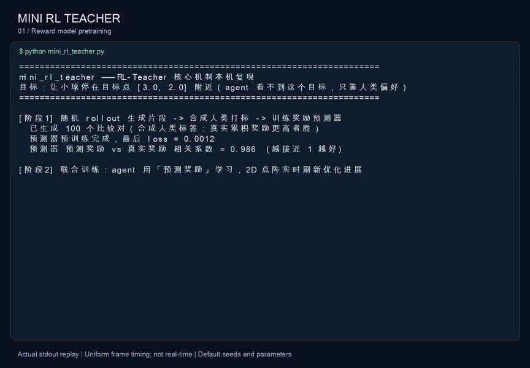
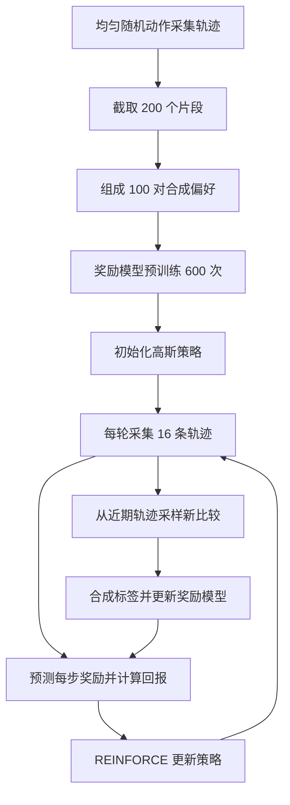

# Mini RL Teacher

[English](README.md) | **简体中文**

仅依赖 NumPy 的偏好强化学习入门项目，包含二维控制任务、学习得到的奖励模型和终端可视化。

本项目以 [mini_rl_teacher.py](mini_rl_teacher.py) 为学习入口，用一个独立 Python 文件展示完整闭环：**比较行为片段 → 学习奖励模型 → 用预测奖励优化策略 → 收集新的比较**。

迷你版本使用二维小球环境、合成偏好和 REINFORCE，神经网络、反向传播与 Adam 均由 NumPy 实现。仓库同时保留原始 RL-Teacher 的 MuJoCo、TRPO/PPO 和人工标注网页代码，供对照阅读。原项目实现了 Christiano 等人 2017 年的 [Deep Reinforcement Learning from Human Preferences](https://arxiv.org/abs/1706.03741)；迷你版本用于理解核心机制，不是论文实验结果的复现。

## 运行 Demo

[](https://github.com/InfronAI/mini-rl-teacher/raw/refs/heads/main/docs/demo/mini-rl-teacher.mp4)

[观看 / 下载 MP4 视频](https://github.com/InfronAI/mini-rl-teacher/raw/refs/heads/main/docs/demo/mini-rl-teacher.mp4) · [完整终端输出](docs/demo/terminal.txt) · [运行记录](docs/demo/run.json)

视频来自未修改的 `mini_rl_teacher.py` 默认配置实际运行，包含预训练、全部 101 个训练画面和最终评估。将终端输出重新排版为约 43 秒的回放，每个训练画面停留 0.32 秒；播放时间不代表实际训练耗时。

本次使用 Python 3.11、NumPy 2.4.6，完成 1,000 轮训练后的确定性策略评估为：平均终点 `(6.00, 4.78)`、平均终点距离 `4.10`、平均真实累计奖励 `-91.79`、50 条轨迹成功率 `0%`。**这次默认运行没有收敛**，视频保留了实际结果，也展示了为什么不能把脚本固定的完成提示当作成功判定。不同运行环境与随机序列可能产生不同结果。

视频制作及复现方式见 [docs/demo/README.md](docs/demo/README.md)。

## 快速开始

在仓库根目录创建独立环境，安装 NumPy 后运行：

```bash
python3 -m venv .venv
source .venv/bin/activate
python -m pip install numpy
python mini_rl_teacher.py
```

Windows PowerShell 使用 `.venv\Scripts\Activate.ps1` 激活环境，其余命令相同。

迷你版本只需要 Python 3 和 NumPy，无需安装仓库根目录的 `setup.py`，也不需要 MuJoCo、TensorFlow、GPU、数据库或云存储。根目录的 `pip install -e .` 面向历史实现，会引入其旧依赖。

运行后依次进行奖励模型预训练、策略与奖励模型联合训练、最终评估。终端会显示目标和小球的平均终点；建议使用支持 ANSI 光标控制和 Unicode 的终端。脚本目前没有命令行参数，训练配置直接写在文件中，也不会自动保存模型或训练结果。

## 任务：从偏好中学习靠近目标

虽然类名是 `ToyLineEnv`，环境实际为二维平面：

| 项目 | 实现 |
| --- | --- |
| 状态 | `[x, y, vx, vy]`，位置和速度，共 4 维 |
| 动作 | `[fx, fy]`，两个方向的控制力，分别裁剪到 `[-1, 1]` |
| 初始状态 | 位置在 `[-1, 1]²` 内随机，速度为零 |
| 世界边界 | 两个坐标均在 `[-6, 6]` 内 |
| 轨迹长度 | 每个 episode 固定 30 步 |
| 目标 | 固定位置 `[3, 2]` |
| 真实奖励 | 动作执行后，到目标的欧氏距离取负值 |

每一步先更新速度，再更新位置：

```python
vel = clip(0.9 * vel + action, -3, 3)
pos = clip(pos + 0.1 * vel, -6, 6)
true_reward = -norm(pos - TARGET)
```

策略能观察小球的位置和速度，但目标坐标没有作为输入交给策略或奖励网络。目标信息通过偏好标签间接传入学习过程。

示例明确写出了真实奖励，用它模拟人的判断：两段轨迹中，真实累计奖励更高的一段获胜。**真实奖励用于生成标签和评估，策略更新使用奖励模型的预测值。** 当前迷你版本没有人工点击标注流程；它对应原项目的 `synth` 模式。

## 训练流程



### 1. 生成初始偏好数据

`segments_from_rand_rollout()` 使用均匀随机动作探索环境，不读取状态来决定动作。每条轨迹随机截取一个 15 步片段，默认收集 200 个片段，前后两半配成 100 对。

`SyntheticComparisonCollector` 比较两侧的 `original_rewards.sum()`，左侧严格更高记为 `0`，否则记为 `1`。这里没有平局标签。

每条轨迹的主要字段为：

| 字段 | 含义 | 默认完整轨迹形状 |
| --- | --- | --- |
| `obs` | 执行动作前的位置与速度 | `(30, 4)` |
| `actions` | 传给环境的动作 | `(30, 2)` |
| `original_rewards` | 动作执行后的真实奖励 | `(30,)` |
| `human_obs` | 动作执行后的位置，供可视化与评估使用 | `(30, 2)` |

### 2. 用比较训练奖励模型

`ComparisonRewardPredictor` 将缩放后的状态与动作拼接，输入 `MLP`：

```text
状态 4 维 + 动作 2 维
→ Dense(64) + LeakyReLU
→ Dense(64) + LeakyReLU
→ Dense(1)：每步预测奖励
```

同一个网络分别给左右片段评分，片段得分是逐步奖励之和：

$$
S_L = \sum_t \hat r_\theta(s_t^L,a_t^L), \qquad
S_R = \sum_t \hat r_\theta(s_t^R,a_t^R)
$$

选择左侧的预测概率为：

$$
P(L) = \frac{e^{S_L}}{e^{S_L}+e^{S_R}}
$$

用左右选择标签计算交叉熵，再通过手写反向传播和 Adam 更新网络。每次最多抽取 64 对比较，预训练默认更新 600 次。学习目标是匹配偏好，不是回归真实奖励的数值；预测奖励的绝对值不能直接与真实奖励比较。代码注释中的 `q` 表示即时奖励预测，不是 Q 函数。

### 3. 初始化并训练策略

预训练结束后才创建 `Policy`。它没有隐藏层，也没有加载训练好的权重：

```python
W = rng.randn(4, 2) * 0.01
b = np.zeros(2)
log_std = np.full(2, -0.7)
```

动作均值与实际采样方式为：

```python
mean = tanh((obs * OBS_SCALE) @ W + b)
sigma = exp(log_std) * explore_scale
action = clip(mean + sigma * noise, -1, 1)
```

`noise` 是标准高斯噪声。初始均值接近零，未乘退火系数时标准差约为 `0.497`。`W`、`b` 和 `log_std` 都参与训练；尽管类注释写着“标准差固定”，实际实现会更新它。

生成初始数据的均匀随机策略，与这里的高斯策略是两个独立阶段，前者不会转化成后者的权重。

联合训练的连接点在 `main()` 中：

```python
path = do_rollout(env, lambda ob: policy.act(ob)[0])
pred_rewards = predictor.predict_reward(path)
predictor.path_callback(path)
returns = reward_to_go(pred_rewards)
```

每轮采集 16 条轨迹，用折扣系数 `0.99` 计算预测奖励的 reward-to-go，再将整个批次的回报标准化，作为 `adv` 传给 `Policy.update()`。这里没有学习状态价值函数；它是简化的 REINFORCE 更新，不是 TRPO 或 PPO。

`path_callback()` 同时维护最近 200 个候选片段，按标签调度增加比较，并定期训练奖励模型。历史比较保留在收集器中。更新是串行交替执行的；同一批轨迹的奖励可能由不同更新时刻的奖励模型给出。

### 4. 评估策略

训练完成后，用 `act_mean()` 去掉探索噪声，在 50 个随机初始位置上运行，报告平均终点、平均终点距离、平均真实累计奖励，以及终点距离不超过 `0.5` 的比例。

这衡量的是有限时长内靠近目标的能力。奖励没有直接惩罚速度，终点成功率也没有检验是否停稳；若关心稳定停留，需要额外观察末段距离和速度。

## 如何解读终端输出

| 输出 | 含义与边界 |
| --- | --- |
| `▼` | 目标位置 |
| `●` | 本批 16 条训练轨迹的平均终点，不是单条轨迹的实时位置 |
| `★` | 平均终点与目标映射到同一个字符格，不代表精确重合 |
| 真奖励 | 本批轨迹的平均真实累计奖励，越接近零越好 |
| 距目标 / 命中 | 平均终点到目标的距离；不同方向的误差可能互相抵消 |
| 预测器相关系数 | 20 条均匀随机策略轨迹上，预测总分与真实总分的相关性 |
| 比较对 | 已创建的比较数量，不是成功轨迹数 |

预训练后会单独输出一次相关系数；联合训练画面中的数值初始化为 `0`，在满足绘制条件的每 100 轮重新计算，其他时候显示上次的值。它不能充分代表奖励模型在当前策略所访问状态上的准确性。

末尾“真实目标已基本达成”是脚本固定打印的文字，**不是自动判定的结论**。应以最终距离和成功率为准，不预设每次运行都能收敛。

## 配置与收敛

脚本没有 `--seed` 或 `--iters` 等参数，需要编辑相应常量或 `main()` 中的配置。

| 配置 | 默认值 | 位置 |
| --- | --- | --- |
| 目标位置 `TARGET` | `[3, 2]` | 文件顶部 |
| 轨迹长度 `EPISODE_LEN` | `30` | 文件顶部 |
| 片段长度 `SEG_LEN` | `1.5 × 10 = 15` | 文件顶部 |
| 联合训练轮数 `N_ITERS` | `1000` | 文件顶部 |
| 绘制间隔 `DRAW_EVERY` | `10`，另绘制第 1 轮 | 文件顶部 |
| 初始片段 / 比较 / 奖励更新次数 | `200 / 100 / 600` | `main()` |
| 每轮轨迹数 | `16` | `main()` |
| 标签目标 / 调度时间尺度 | `1500 / 21000` 步 | `LabelSchedule` 的创建处 |
| 奖励网络学习率 / 最大批量 | `0.001 / 64` | `MLP` / `train_predictor()` |
| 策略学习率 | `0.1` | `main()` 创建 `Policy` 时 |
| 探索系数 | 从接近 `1` 线性降到 `0.05` | 联合训练循环 |

默认联合训练为 `1000 × 16 × 30 = 480000` 个环境步，不含预训练和评估采样。标签调度的时间尺度仍为 `70 × 10 × 30 = 21000` 步，因此标签目标较早接近上限；实际比较数还受每条轨迹最多新增一对的限制。缩短 `N_ITERS` 也会加速探索退火，不只是缩短运行时间。修改轨迹长度时，应保证它不小于片段长度，否则初始采样无法收集到片段。

初始策略和初始数据都会影响收敛。前者决定早期探索方向，后者决定奖励模型最先学会区分哪些行为；二者通过后续采样形成反馈。靠近目标与接近后减速需要不同的轨迹证据，初始随机数据不保证覆盖这些行为。

比较初始化的影响时，可以固定初始数据与奖励模型，仅改变策略种子，再反过来固定策略、改变数据。记录多次训练的最终距离与成功率，而不是只观察平均终点图。

当前全局 NumPy、环境和奖励模型种子为 `0`，策略初始化种子为 `1`。`segments_from_rand_rollout()` 的 `seed` 参数没有在函数内部使用；采样使用全局随机状态。相关系数评估也复用训练环境和全局随机源，改变评估调用次数会影响后续随机序列。

## 当前实现的限制

以下描述的是现有代码行为，尚未在实现中修复：

- **动作裁剪与梯度不一致。** 策略先采样高斯动作，再裁剪后执行；更新却把裁剪动作代入普通高斯的对数概率梯度。发生裁剪时存在偏差。`act()` 已返回裁剪前动作，但主流程只保存裁剪后的动作。
- **探索噪声不保证单调下降。** 外部系数会退火，但 `log_std` 同时由优化器学习，实际标准差取决于两者。
- **比较可能重复。** 在线随机配对可能选到同一个片段，合成标签却将相等分数记为右侧获胜；这种比较无法提供有效的方向信息。
- **奖励更新频率是近似值。** 回调累计至少 100 步后更新并清零，默认每条轨迹 30 步，实际每 120 步更新一次。
- **泛化与训练稳定性有限。** 使用单个奖励网络、随机配对、固定输入缩放，没有独立偏好验证集、价值网络、信赖域约束或策略裁剪目标。
- **没有持久化与自动验收。** 模型、优化器和比较数据保存在内存；尚无针对迷你版本的自动化训练测试或收敛保证。

## 对照原始项目阅读

```text
mini_rl_teacher.py           # 主要入口：NumPy 教学实现
rl_teacher/
  teach.py                  # 原始训练入口与奖励预测器
  nn.py                     # Keras 奖励网络
  envs.py                   # MuJoCo 环境包装、奖励调整、状态回放
  segment_sampling.py       # 随机采样与片段切分
  comparison_collectors.py  # 合成标签、人工标签、视频任务
  label_schedules.py        # 标签预算调度
  video.py                  # 视频编码与 GCS 上传
  summaries.py              # TensorBoard 指标
agents/
  parallel-trpo/            # 并行 TRPO
  pposgd-mpi/               # PPO 与 MPI 支持
  simple-trpo/              # 独立的实验性 TRPO 实现
human-feedback-api/         # Django 比较记录、标注页面及数据库迁移
```

| 迷你版本 | 原始模块 | 主要区别 |
| --- | --- | --- |
| `ToyLineEnv` | [envs.py](rl_teacher/envs.py) | 二维小球替代 MuJoCo；位置数组替代可回放的物理状态 |
| `do_rollout`、`sample_segment_from_path` | [segment_sampling.py](rl_teacher/segment_sampling.py) | 单进程 NumPy 采样 |
| `SyntheticComparisonCollector` | [comparison_collectors.py](rl_teacher/comparison_collectors.py) | 仅合成左右偏好，无人工网页与视频上传 |
| `LabelSchedule` | [label_schedules.py](rl_teacher/label_schedules.py) | 保留按步数退火的标签目标 |
| `MLP`、`ComparisonRewardPredictor` | [nn.py](rl_teacher/nn.py)、[teach.py](rl_teacher/teach.py) | 手写前反向传播，无 TensorFlow/Keras 或 Dropout |
| `Policy` | [parallel-trpo](agents/parallel-trpo)、[pposgd-mpi](agents/pposgd-mpi) | 简化为线性均值加 tanh 的高斯策略与 REINFORCE |
| `ascii_grid`、`render_frame` | [video.py](rl_teacher/video.py)、[summaries.py](rl_teacher/summaries.py) | 终端平均终点展示替代视频和 TensorBoard |

建议先阅读迷你文件中的 `main()`，再顺着 `do_rollout()` → `train_predictor()` → `Policy.update()` 理解数据和梯度，最后对照原项目的奖励替换接口。

### 原始实现的运行背景

原始入口是 `rl_teacher/teach.py`，有 `rl`、`synth`、`human` 三种模式。`rl` 直接使用环境奖励作为对照实验；`synth` 使用合成偏好；`human` 使用人工反馈。它们各自开始训练，`rl` 模式不会自动为其他模式提供预训练策略。

原代码围绕 Python 3.5、TensorFlow 1.2、Gym 0.9 和 mujoco-py 0.5 构建，包含旧版接口，不能直接套用上述迷你版本的安装步骤。在准备好兼容的历史运行环境后，入口示例为：

```bash
# 真实奖励对照
python rl_teacher/teach.py -p rl -e ShortHopper-v1 -n base-rl

# 合成偏好
python rl_teacher/teach.py -p synth -l 1400 -e ShortHopper-v1 -n syn-1400

# 人工偏好：需先准备数据库、标注网页、视频渲染和 GCS
python rl_teacher/teach.py -p human --pretrain_labels 175 -e Reacher-v1 -n human-175
```

人工反馈通过 Django ORM 直接读写 `Comparison`，训练进程与网页必须访问同一数据库。视频异步上传到 `RL_TEACHER_GCS_BUCKET` 指定的 GCS 路径，浏览器通过媒体 URL 播放；不是训练进程通过 HTTP 调用标注 API。网页入口说明见 [human-feedback-api/README.md](human-feedback-api/README.md)。

原始环境包装器可能调整奖励或终止条件，日志中的 `original_rewards` 是包装后的环境奖励。原始代码及其测试属于历史研究实现，保留用于对照，并不代表已在当前环境通过训练验证。

## 来源与许可

本项目保留 RL-Teacher 原始实现，以迷你示例解释其偏好学习机制。感谢 Paul Christiano 和 Dario Amodei 对原系统的设计与支持，Max Harms 对并行 TRPO 集成和训练的贡献，Catherine Olsson 对原项目文档与可用性的改进，以及 Kevin Frans 的并行 TRPO 实现。

相关扩展：[rl-teacher-atari](https://github.com/machine-intelligence/rl-teacher-atari)。许可见 [LICENSE](LICENSE)。
